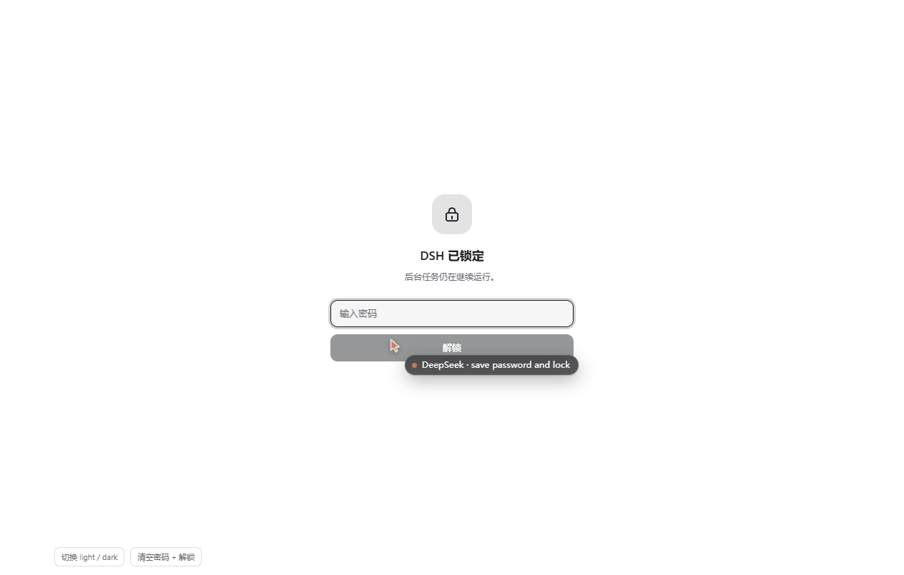
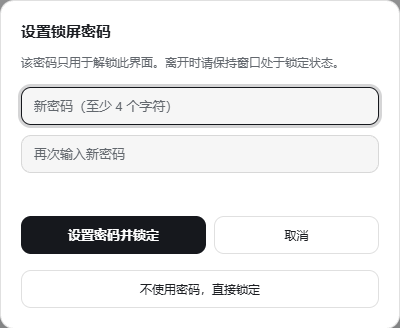
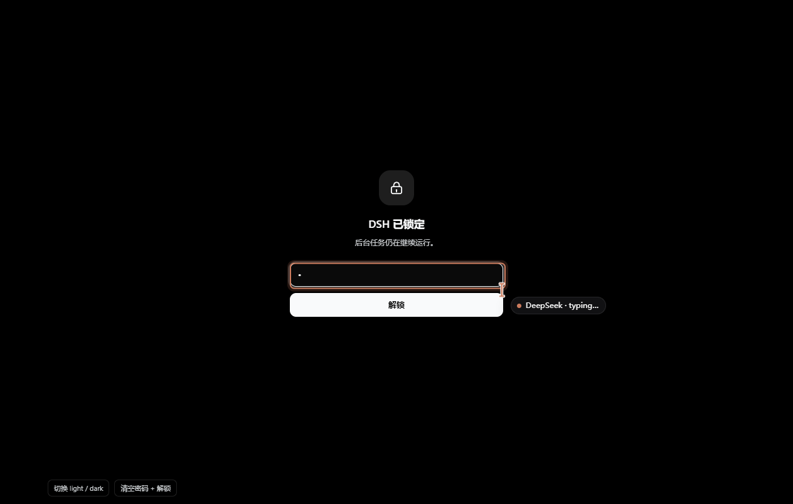

# DSH Lock Screen

English | [中文](README.zh.md)

A full-screen password lock for [DeepSeek Harness](https://github.com/deepseek-ai/deepseek-harness) (`dsh`).
Running long tasks? Lock the UI before you walk away, and nobody passing your desk sees a session, a
tool call, a file path or an API key spelled out in a diff.

The lock is **purely visual**. The agent keeps running in the Host process the whole time — the plugin
never touches sessions, timers, streams or the sandbox. It does not even have a handle to them.



## Features

- **One click or one shortcut.** A lock button at the sidebar foot, and `Ctrl/Cmd + Shift + L` from anywhere.
- **Password gate.** Salted SHA-256 in `localStorage`; the plaintext never leaves the password field.
- **Survives a reload.** The locked state is persisted, so refreshing the page, reopening the window or
  restarting DSH still shows the lock — not the session behind it. Multiple tabs sync through `storage` events.
- **Password optional.** You can lock without a password (unlock = one click on a screen only you asked for),
  or remove the password later from the same panel.
- **Brute-force brakes.** Three wrong attempts start a cooldown (5 s, doubling, capped at 60 s) with a live
  countdown; input and button stay disabled until it expires.
- **Hides the title too.** The page title becomes `DSH (locked)` while locked, and is restored on unlock.
- **Follows the theme.** Light and dark, using only Harness `--dsw-alias-*` tokens (surfaces derived with
  `color-mix`), so it does not fight a custom theme.
- **No dependencies, no network, no files.** One client module, no build step, nothing installed at runtime.

## Install

From the DSH plugin manager (recommended — the desktop app's **Settings → Plugins**, or the
`dshmarket` market once this plugin is listed):

```sh
dsh plugin --profile <profile> add dsh-lock-screen
```

From a checkout of this repo:

```sh
dsh plugin --profile <profile> add /path/to/dsh-lock-screen
```

After installing, **refresh the Web UI once** (the client module loads at page load). The lock button
appears at the bottom of the sidebar, next to Settings.

## Use

| Action | How |
| --- | --- |
| Lock now | Click the lock at the sidebar foot, or press `Ctrl/Cmd + Shift + L` |
| Unlock | Type the password and press `Enter` |
| Set / change / remove the password | `Shift` + click the lock (opens the panel without locking) |
| Lock without a password | Third row of the setup panel: “Lock without a password” |

The first time you click the lock, the setup panel asks for a password (at least 4 characters, twice).
Saving it locks immediately.




## What it is not

This is a **privacy screen, not a security boundary**:

- It stops the person who walks past your desk from reading the screen. It does not stop someone who can
  operate the machine — Task Manager, the file manager, another browser, or `localStorage` itself are all
  outside its reach.
- The password is stored as a salted hash in this profile's `localStorage`
  (keys `dsh.lock-screen.credential`, `dsh.lock-screen.locked`). It is not encryption, and there is no
  recovery path: forget it and you clear those two keys (DevTools console) or remove the plugin.
- Background tasks are deliberately unaffected. That is the point: you come back to finished work.

If you need real isolation, use the OS lock screen or a separate OS account.

## How it works

Two slots, one module:

- `sidebar.footer.action` — the lock button (`order: 10`), icon-only when the sidebar is collapsed to a rail.
- `shell.overlay` — the full-screen layer (`order: 100`) holding the lock screen and the setup panel.

`client.js` is a single ES module registered through `window.__ModuleLoader__.load(...)`, written with
`React.createElement` (no JSX, no bundler). It injects exactly two services, `slots` and `locale`, and
registers both slots inside `ctx.effect` so they are removed on unload. UI strings live in
`locale/en.json` / `locale/zh.json` and are read through the locale service, so the panel follows the
Harness language.

State is a small module-level store (`useSyncExternalStore`) persisted to `localStorage`:

| Key | Value |
| --- | --- |
| `dsh.lock-screen.locked` | `"1"` / `"0"` |
| `dsh.lock-screen.credential` | `{"v":1,"salt":"<hex>","hash":"<hex>"}` |

`hash = SHA-256(salt + password)` via WebCrypto; a small fallback keeps it working on hosts without
`crypto.subtle`.

While locked, a capture-phase `keydown` handler swallows shortcuts outside the overlay and keeps `Tab`
inside the password field, so the app behind the layer does not react to a bystander's typing.

## Development

There is no build step. To iterate on the UI without installing, open
[`docs/harness.html`](docs/harness.html) — it loads React from a CDN, fakes the two services,
imports the real `client.js` and renders both slots next to a stub conversation list. It also has a small
HUD to flip light/dark and reset the stored password.

Because the module is loaded through the plugin manager's symlinked copy, an edit under this folder is
live **after a page refresh** in a running GUI.

## Compatibility

- DSH `>= 0.2.1-rc.4` (Web UI, desktop app included).
- Verified on DSH Desktop `2.0.21-next` / `dsh 0.2.1-rc.4`, light and dark.
- Languages: English, 简体中文.

## License

[MIT](LICENSE) © Zhang Xi
