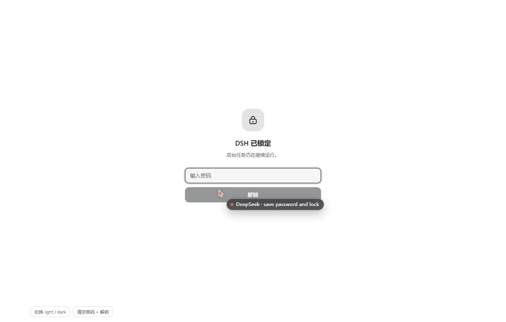
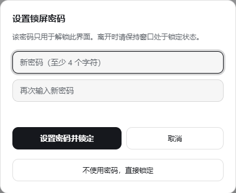
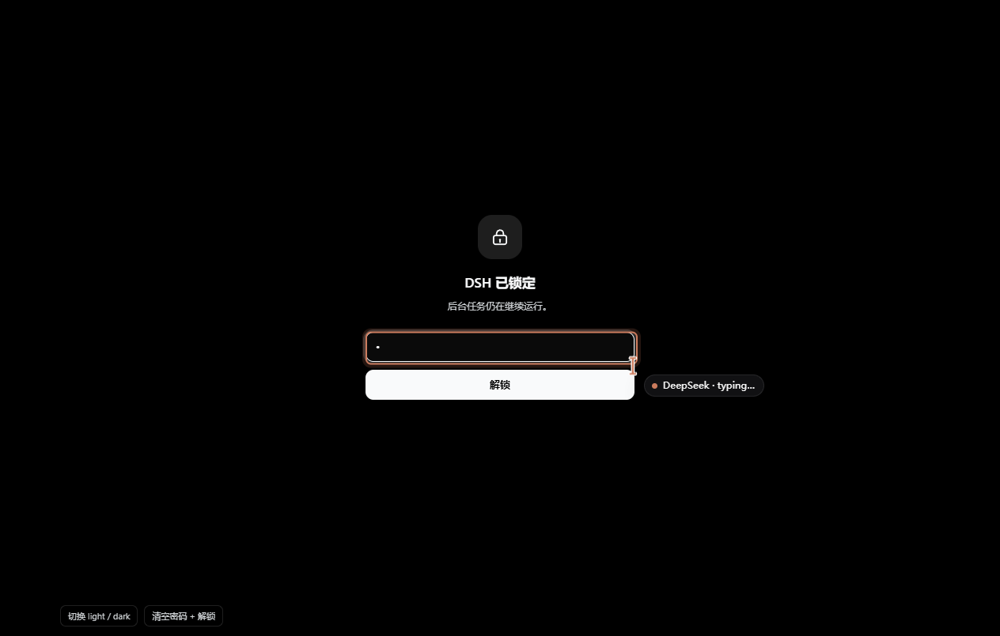

# DSH 锁屏

[English](README.md) | 中文

给 [DeepSeek Harness](https://github.com/deepseek-ai/deepseek-harness)（`dsh`）用的全屏密码锁。
跑着长任务要离开工位时锁一下，路过的人就看不到你的会话、工具调用、文件路径，也看不到 diff 里摊开的 key。

锁只遮界面。**agent 全程在 Host 进程里照常跑** —— 这个插件不碰 session、不碰 timer、不碰流、不碰沙箱，
连它们的句柄都没有。



## 特性

- **一键或一个快捷键**：侧边栏底部有锁按钮，任何位置按 `Ctrl/Cmd + Shift + L` 都能锁。
- **密码门**：加盐 SHA-256 存 `localStorage`，明文不出密码框。
- **刷新也不掉锁**：锁定状态持久化，刷新页面、重开窗口、重启 DSH 之后仍是锁屏，而不是身后的会话；
  多个标签页通过 `storage` 事件同步。
- **密码可选**：可以完全不设密码（"解锁"就是点一下），之后也能在同一面板里移除密码。
- **防瞎试**：连续 3 次输错开始冷却（5 秒起、逐次翻倍、上限 60 秒）并实时倒计时，冷却期间输入框和按钮禁用。
- **连标题一起盖**：锁定期间页面标题变成 `DSH（已锁定）`，解锁后复原。
- **跟随主题**：只用 Harness 的 `--dsw-alias-*` token（层次色用 `color-mix` 派生），深浅色都验证过。
- **零依赖、不联网、不写文件**：一个 client 模块，无需构建，运行时不装任何东西。

## 安装

从 DSH 插件管理器安装（推荐：桌面应用的 **设置 → 插件**，或 `dshmarket` 市场——本插件上架后可直接搜到）：

```sh
dsh plugin --profile <profile> add dsh-lock-screen
```

从本仓库的本地目录安装：

```sh
dsh plugin --profile <profile> add /path/to/dsh-lock-screen
```

装完 **刷新一次 Web 界面**（client 模块在页面加载时载入）。锁按钮出现在侧边栏底部、设置图标旁边。

## 使用

| 操作 | 方式 |
| --- | --- |
| 立即锁定 | 点侧边栏底部的锁，或按 `Ctrl/Cmd + Shift + L` |
| 解锁 | 输入密码 + `Enter` |
| 设置 / 修改 / 移除密码 | `Shift` + 点锁（只开面板，不锁定） |
| 不用密码直接锁 | 设置面板第三行「不使用密码，直接锁定」 |

第一次点锁会先让你设置密码（至少 4 个字符，输两遍），保存后立即锁定。




## 它不是什么

这是**遮挡式隐私屏，不是安全边界**：

- 它挡住的是"从你工位走过的人"。挡不住能操作这台电脑的人——任务管理器、文件管理器、另一个浏览器，
  以及 `localStorage` 本身，都在它管辖之外。
- 密码以加盐哈希存在当前 profile 的 `localStorage`（键 `dsh.lock-screen.credential`、
  `dsh.lock-screen.locked`），不是加密，也没有找回通道：忘了就在 DevTools 控制台清掉这两个键，
  或者卸载插件。
- 后台任务**有意不受影响**。这才是重点：你回来时活已经干完了。

真需要隔离，请用系统锁屏或单独的 OS 账户。

## 实现

两个插槽，一个模块：

- `sidebar.footer.action` —— 锁按钮（`order: 10`），侧边栏收成窄轨时只显示图标。
- `shell.overlay` —— 全屏层（`order: 100`），承载锁屏页和设置面板。

`client.js` 是单个 ES 模块，通过 `window.__ModuleLoader__.load(...)` 注册，全部用 `React.createElement`
（无 JSX、无打包）。只注入 `slots` 和 `locale` 两个服务，两个插槽都在 `ctx.effect` 里注册，卸载时自动清理。
文案在 `locale/en.json` / `locale/zh.json`，经 locale 服务读取，跟随 Harness 的语言设置。

状态是一个模块级小 store（`useSyncExternalStore`），持久化到 `localStorage`：

| 键 | 值 |
| --- | --- |
| `dsh.lock-screen.locked` | `"1"` / `"0"` |
| `dsh.lock-screen.credential` | `{"v":1,"salt":"<hex>","hash":"<hex>"}` |

`hash = SHA-256(salt + password)`，走 WebCrypto；宿主没有 `crypto.subtle` 时退回到内置弱哈希，保证可用。

锁定期间，capture 阶段的 `keydown` 会吞掉遮罩外的快捷键，并把 `Tab` 焦点锁在密码框内，
所以别人在键盘上乱按不会操作到遮罩后面的界面。

## 开发

没有构建步骤。想不安装就调 UI，直接打开
[`.preview/harness.html`](.preview/harness.html)：它从 CDN 加载 React、伪造那两个服务、引入真实的
`client.js`，把两个插槽挂在一个假会话列表旁边，还带一个切深浅色 / 清空密码的小 HUD。

插件是软链安装的，所以改完这个目录里的代码，**刷新一次页面**就生效。

## 兼容性

- DSH `>= 0.2.1-rc.4`（Web 界面，含桌面应用）。
- 在 DSH Desktop `2.0.21-next` / `dsh 0.2.1-rc.4` 上验证，深浅色都过。
- 语言：简体中文、English。

## 许可

[MIT](LICENSE) © Zhang Xi
